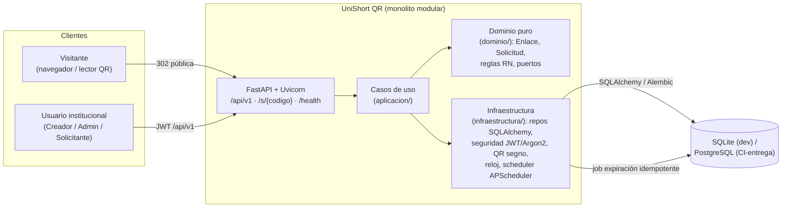
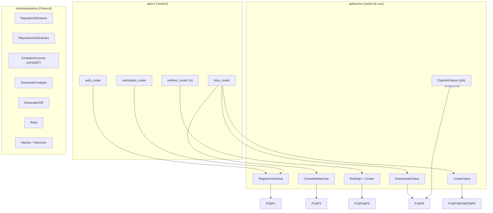

# Plan técnico — UniShort QR (Incremento 001)

| Campo | Valor |
|---|---|
| **Feature** | `001-unishort-qr` (F1) |
| **Versión** | 1.0.0 |
| **Fecha** | 2026-10-20 |
| **Estado** | Aprobado |
| **Vinculados** | `../../.specify/memory/constitution.md` v2.0.0 · `spec.md` v1.0.0 · `clarify.md` v1.0.0 (D1–D15) · `tasks.md` |

## 1. Enfoque

Plan para convertir el spec v1.0.0 en un servicio FastAPI operable, siguiendo la constitución: monolito modular en capas con dominio puro, puertos inyectables, contrato `/api/v1` con envelope universal, integridad garantizada en BD y calidad verificada por CI. Este plan **preserva** las decisiones técnicas del borrador del equipo del 2026-10-12 (HTTP 302, QR del enlace corto, UNIQUE + reintentos Base62, verificación de caducidad en lectura) y las **extiende** con el mecanismo de expiración programada idempotente (D13), que materializa los estados terminales sin cambiar el comportamiento observable de la lectura.

## 2. Decisiones técnicas (P-01–P-10)

| ID | Decisión | Justificación | Alternativas descartadas |
|---|---|---|---|
| **P-01** | Python 3.12 con tipado estricto y `pyproject.toml` de configuración | Lenguaje base del curso; tipado habilita las pruebas de arquitectura y reduce defectos | Mantener solo `requirements.txt` (menos trazabilidad de dependencias de dev) |
| **P-02** | FastAPI 0.14x + Uvicorn como servidor ASGI | OpenAPI automático (Principio IV), inyección de dependencias nativa, validación declarativa | Flask (sin OpenAPI nativo), Django (peso injustificado para F1) |
| **P-03** | Monolito modular en capas: `api/` → `aplicacion/` → `dominio/` ← `infraestructura/`; dominio puro sin framework; puertos con `typing.Protocol`; reloj inyectable | Principios II/III; testeable sin servidor; aísla SQLite→PostgreSQL (D12/D14) | Microservicios (sobre-ingeniería para F1), FastAPI como modelo de dominio (acopla framework a reglas) |
| **P-04** | SQLAlchemy 2.x (estilo 2.0, `Mapped[...]`) + Alembic; SQLite en dev/pruebas, PostgreSQL en CI/entrega (D12) | Integridad (Principio VI) con migraciones reversibles verificadas en CI | ORM CRUD puro sin migraciones (rompe reversibilidad), SQL crudo (pérdida de portabilidad) |
| **P-05** | Pydantic v2 (DTOs de API) + `pydantic-settings` (configuración por entorno: `BASE_URL`, umbrales, secretos) | Validación en el borde; constantes de reglas (240/180 días, 2048) centralizadas para responder Q1–Q5 cambiando config | Variables sueltas en código (no trazables), `os.environ` directo (sin validación) |
| **P-06** | QR con segno: PNG (base64 en JSON) y SVG | Generación pura en Python sin binarios externos, soporte SVG nativo (D8) | qrcode+Pillow (dependencia de imagen pesada), servicio externo de QR |
| **P-07** | Seguridad: JWT HS256 con `pyjwt`; hash Argon2id con `pwdlib[argon2]`; roles `creador`/`administrador` en claims | RNF-07; simple de operar en F1; puertos de seguridad listos para SSO en F2 (D2) | Sesiones de servidor (acopla estado), OAuth completo (fuera de alcance F1) |
| **P-08** | Expiración: job APScheduler idempotente (transiciona ACTIVO→EXPIRADO) + verificación en lectura en la ruta caliente (D13) | El job materializa el estado observable; la lectura garantiza corrección aunque el job atrase (Principio VIII) | Solo job (riesgo de redirigir vencidos entre corridas), solo lectura (estados nunca materializados, auditoría débil) — era la ambigüedad del plan del 2026-10-12 |
| **P-09** | Calidad: ruff (lint+format), pytest, `freezegun` (tiempo), `httpx` (cliente de pruebas), cobertura mínima en dominio/aplicación; CI GitHub Actions: ruff → pytest SQLite → pytest concurrencia con servicio PostgreSQL → `alembic upgrade head` + `downgrade base` | Principios IX/XIII; CA-11 verificable de forma automática | Pruebas manuales (no repetibles), pytest-bdd (sobrecarga para F1) |
| **P-10** | GitFlow simplificado (main protegida, develop, feature/*) + Conventional Commits + revisión cruzada en PR | Principio XII; política evaluable del curso (D15) | Trunk-based (sin control de curso por PR), commits libres (sin trazabilidad) |

## 3. Vista C2 — Contenedores



## 4. Vista C3 — Componentes de la capa API/aplicación



Las implementaciones de puertos viven en `infraestructura/` y se inyectan en el arranque (`main.py`): repos SQLAlchemy, generador Base62, generador segno, reloj de sistema, hasher Argon2id, tokenizer JWT.

## 5. Estructura de carpetas

```
app/
  main.py                # fábrica de app, inyección, excepciones→envelope, /health
  api/v1/
    auth.py              # POST /api/v1/auth/token
    solicitudes.py       # POST /api/v1/solicitudes
    links.py             # POST/GET/PATCH /api/v1/links...
    redirect.py          # GET /s/{codigo} (302/404/410)
    envelope.py          # helpers del envelope y manejo de errores
  aplicacion/
    crear_enlace.py
    redirigir.py
    desactivar_enlace.py
    consultar_metricas.py
    expirar_enlaces.py   # caso de uso idempotente del job
    registrar_solicitud.py
  dominio/
    entidades.py         # Enlace, Solicitud, Usuario, AccesoDiario (sin framework)
    reglas.py            # RN-01..RN-11 como funciones/validaciones puras
    errores.py           # excepciones de dominio ↔ códigos del catálogo
    puertos.py           # Protocols P1..P7
  infraestructura/
    db.py                # engine, sesión, base
    modelos_orm.py       # mapeo SQLAlchemy
    repositorios.py      # implementaciones de puertos (SELECT FOR UPDATE)
    contador.py          # UPSERT atómico acceso_diario
    codigos.py           # Base62×7 + reintentos
    qr.py                # segno PNG/SVG
    seguridad.py         # Argon2id + JWT HS256
    reloj.py             # reloj real (inyectable; freezegun en pruebas)
    scheduler.py         # APScheduler → expirar_enlaces
alembic/
  versions/              # migraciones reversibles (upgrade/downgrade)
tests/
  unit/                  # dominio puro (reglas, códigos, tiempo con freezegun)
  integracion/           # casos de uso + API sobre SQLite
  concurrencia/          # UPSERT/colisiones sobre PostgreSQL (marcadas para CI)
.github/workflows/ci.yml
```

## 6. Modelo de datos (físico)

| Tabla | Columnas clave | Integridad |
|---|---|---|
| `usuario` | id PK, nombre, correo UNIQUE, hash_contrasena, rol | hash Argon2id (RNF-07) |
| `solicitud` | id PK, solicitante_id FK, url_destino, vigencia_deseada, estado (PENDIENTE/PROCESADA/RECHAZADA), timestamps | **Índice parcial único** `(solicitante_id, url_destino) WHERE estado='PENDIENTE'` (RN-08) |
| `enlace` | id PK, codigo_corto, url_destino, estado (ACTIVO/EXPIRADO/DESACTIVADO), fecha_creacion, fecha_caducidad, ultimo_acceso (nullable), creador_id FK, solicitud_id FK nullable | **UNIQUE(codigo_corto)** (RN-02); CHECK estado; índice por estado y por fecha_caducidad para el job |
| `acceso_diario` | enlace_id FK, fecha (día, UTC), total | **PK compuesta (enlace_id, fecha)** + UPSERT atómico `INSERT ... ON CONFLICT DO UPDATE SET total = total + 1` (RF-08) |

Operaciones transaccionales: creación valida y persiste enlace+solicitud en una transacción con reintentos ante violación de UNIQUE (E-09); desactivación usa `SELECT FOR UPDATE` sobre el enlace para transición segura (D4); el job de expiración procesa por lotes con límite y es re-ejecutable (idempotente, D13/P-08).

## 7. Excepciones al envelope

Tres respuestas NO usan el envelope (Principio V): (1) `GET /s/{codigo}` → RedirectResponse 302/404/410 con `Location`/envelope de error JSON según el caso (el 410/404 de redirección SÍ lleva envelope con el catálogo; el 302 es HTML puro de protocolo); (2) binario/base64 del QR (content-type de imagen cuando se sirva como archivo); (3) 204/HEAD sin cuerpo.

## 8. Riesgos técnicos y mitigación

| Riesgo | Mitigación |
|---|---|
| Diferencias SQLLite/PostgreSQL en UPSERT y FKs | UPSERT estándar SQLAlchemy `on_conflict_do_update`; pruebas de concurrencia solo contra PostgreSQL en CI (CA-11) |
| Reloj/zonas horarias en expiración | Todo UTC con reloj inyectado; pruebas con `freezegun` de frontera (E-06) |
| Latencia de QR en creación | Generación en memoria (segno es rápido); presupuesto RNF-02 con prueba de temporización |
| Confirmaciones externas (D1/D2/D3/D5/D12) cambian constantes | Config centralizada `pydantic-settings` (P-05): cambio de una línea, cero impacto en contrato |
| Job duplica transiciones | Idempotencia por diseño (solo transiciona desde ACTIVO) + prueba de doble ejecución (Principio VIII) |

## 9. Historial

| Versión | Fecha | Cambios |
|---|---|---|
| 0.1.0 (repo inicial) | 2026-10-12 | Borrador del equipo: stack, capas, modelo Usuario/Enlace/Métrica, endpoints previstos y decisiones 302/QR/UNIQUE/caducidad-en-lectura (absorbidos por P-02, P-03, P-04, P-06, P-08). |
| 1.0.0 | 2026-10-20 | Plan completo: P-01–P-10, vistas C2/C3, estructura de carpetas, modelo físico con integridad (UPSERT, FOR UPDATE, índice parcial único), excepciones al envelope, riesgos. |
