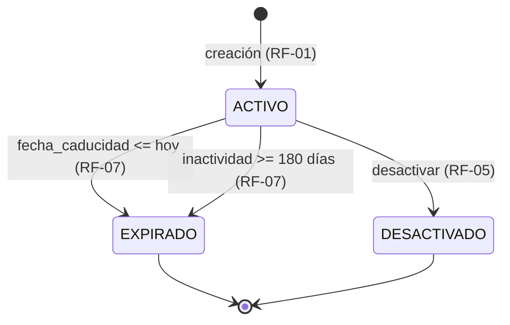

# Especificación — UniShort QR (Incremento 001)

| Campo | Valor |
|---|---|
| **Feature** | `001-unishort-qr` (F1 — núcleo del servicio) |
| **Versión** | 1.0.0 |
| **Fecha** | 2026-10-20 |
| **Estado** | Aprobada |
| **Vinculados** | `../../.specify/memory/constitution.md` v2.0.0 · `clarify.md` v1.0.0 (D1–D15) · `plan.md` v1.0.0 · `tasks.md` |

## 1. Problema

La Universidad Nacional de Loja difunde recursos digitales (formularios, convocatorias, materiales) mediante URLs largas que son imprácticas en material impreso, radios, carteles y redes sociales, y sin ningún mecanismo de medición de alcance. Los QR generados ad-hoc codifican la URL final: si el destino cambia, todo el material impreso queda obsoleto, y la institución no sabe cuántas personas accedieron ni cuándo. UniShort QR resuelve esto con un servicio institucional que genera enlaces cortos bajo dominio UNL con códigos QR dinámicos (el QR apunta al enlace corto, no al destino), con control de vigencia, administración por roles y métricas de uso agregadas sin recabar datos personales de los visitantes.

## 2. Alcance del incremento F1

**Dentro del alcance (F1):**
- Creación de enlaces cortos con código Base62 único, vigencia obligatoria y QR (PNG/SVG).
- Redirección pública HTTP 302 con registro de accesos agregado por día.
- Expiración por fecha y por inactividad (job idempotente + verificación en lectura).
- Administración: listar, consultar y desactivar enlaces propios (Creador) o institucionales (Administrador).
- Métricas agregadas por enlace para su creador/administrador.
- Autenticación institucional local (JWT) con roles.

**Fuera del alcance (F1):** creación masiva en lote; analítica avanzada (geolocalización, referentes, embudos); personalización visual del QR (colores, logos); códigos cortos personalizados elegidos por el usuario; notificaciones por correo; integración SSO con el directorio institucional; reactivación de enlaces terminales. Elementos registrados como candidatos en `clarify.md` §3 (Q6–Q8) para futuros incrementos.

## 3. Actores y permisos

| Actor | Descripción | Permisos en F1 |
|---|---|---|
| **Visitante** | Cualquier persona que escanea un QR o escribe un enlace corto. No se autentica. | Redirección pública (302/404/410). |
| **Solicitante** | Docente o administrativo que necesita un enlace corto para un recurso. | Registrar una solicitud de enlace (pendiente de creación o creación directa si tiene rol Creador). |
| **Creador** | Usuario institucional autenticado con rol de creación (personal de unidades designado). | Crear enlaces+QR, listar/gestionar los propios, desactivar los propios, ver métricas de los propios. |
| **Administrador** | Personal DTI/TI con rol administrativo. | Todo lo anterior sobre cualquier enlace + visión institucional + auditoría de estados. |

Nota: una misma persona puede actuar como Solicitante y Creador (roles por cuenta, no por persona). Solicitante y Creador pueden coincidir en una sola cuenta con rol Creador.

## 4. Historias de usuario

| ID | Historia | Criterio esencial |
|---|---|---|
| **US-01** | Como **Visitante**, quiero escanear un QR o escribir un enlace corto y llegar al recurso sin fricción, para no perder tiempo. | Redirección 302 < 1 s; 404 si no existe; 410 si está expirado/desactivado. |
| **US-02** | Como **Solicitante**, quiero registrar una petición de enlace corto con destino y vigencia, para que la unidad correspondiente la atienda sin correos de por medio. | Solicitud registrada; rechazo inmediato de destinos inválidos/prohibidos; sin duplicados pendientes del mismo destino. |
| **US-03** | Como **Creador**, quiero crear un enlace corto con vigencia y obtener su QR (PNG/SVG), para difundirlo de inmediato en material impreso. | 201 con código, URL corta, QR y fechas; creación total ≤ 2 s. |
| **US-04** | Como **Creador**, quiero listar mis enlaces con su estado y vigencia, para mantener mi inventario bajo control. | Listado paginado con estado, fechas y contadores; solo los propios (o todos si Administrador). |
| **US-05** | Como **Creador**, quiero desactivar un enlace mío cuando el recurso sale de circulación, para impedir accesos Posteriores. | 204; el enlace pasa a DESACTIVADO (terminal); las redirecciones pasan a 410. |
| **US-06** | Como **Creador**, quiero consultar métricas agregadas de un enlace mío, para evaluar el alcance de la difusión. | Totales y serie por día; sin ningún dato de visitantes. |
| **US-07** | Como **Administrador**, quiero administrar y auditar cualquier enlace institucional, para aplicar políticas (retiro por vigencia vencida, revisión de destinos). | Acceso a listado global, detalle y desactivación de terceros con auditoría de acción. |

## 5. Requisitos funcionales

| ID | Requisito | Detalle contractual |
|---|---|---|
| **RF-01** | Crear enlace corto + QR | Un Creador autenticado envía destino, vigencia y datos de la solicitud; el sistema valida (RN-05), genera código Base62×7 único (RN-02), persiste el enlace ACTIVO y retorna URL corta absoluta + QR PNG (base64) + metadatos. Opcionalmente retorna el QR en SVG (Accept). La creación parte de una solicitud del Solicitante o es directa si el Creador la origina. |
| **RF-02** | Redirigir | `GET /s/{codigo}` resuelve el enlace: si ACTIVO y vigente → HTTP 302 con `Location` al destino y registro atómico del acceso diario (RF-08). Si no existe → 404 `ENLACE_NO_ENCONTRADO`. Si EXPIRADO o DESACTIVADO → 410 `ENLACE_NO_DISPONIBLE`. La verificación de vigencia ocurre en lectura (D13) aunque el job no haya corrido. |
| **RF-03** | Generar QR | El QR codifica SIEMPRE la URL corta pública (RN-09), se genera con segno y se expone en PNG (base64 en la creación) y SVG. |
| **RF-04** | Autenticar y autorizar | Login institucional usuario/contraseña → JWT HS256 de corta vida. Escrituras exigen token válido con rol adecuado (Creador/Administrador); el visitante accede solo a la redirección pública. Credenciales inválidas → 401 `CREDENCIALES_INVALIDAS`; rol insuficiente → 403 `PERMISO_DENEGADO`. |
| **RF-05** | Administrar enlaces | Listar (paginado, con filtros por estado), consultar detalle (incluye vigencia restante) y desactivar enlaces. El Creador opera los suyos; el Administrador, cualquiera. Desactivar es transición a DESACTIVADO (terminal, RN-06); sobre un enlace terminal → 409 `TRANSICION_NO_PERMITIDA`. |
| **RF-06** | Métricas agregadas | `GET /links/{id}/metrics` retorna total acumulado y serie diaria del enlace (solo del propietario o Administrador). Ninguna métrica expone datos de visitantes (RN-07). |
| **RF-07** | Expiración idempotente | Job programado (APScheduler) que transiciona ACTIVO→EXPIRADO cuando `fecha_caducidad` ≤ ahora o `ultimo_acceso` con inactividad ≥ 180 días (RN-04). Re-ejecutar el job no produce duplicados ni errores (idempotente). La lectura también aplica la regla (defensa en profundidad, D13). |
| **RF-08** | Conteo atómico de accesos | Cada redirección registra el acceso con UPSERT atómico en `acceso_diario` (enlace, día) → suma 1 bajo concurrencia sin lecturas-escrituras intermedias; actualiza `ultimo_acceso` del enlace. |

## 6. Reglas de negocio

| ID | Regla |
|---|---|
| **RN-01** | Todo enlace DEBE tener fecha de caducidad; la vigencia máxima es 240 días naturales desde la creación (D3). Solicitudes sin vigencia → 422 `VIGENCIA_REQUERIDA`; vigencia > máximo → 422 `VIGENCIA_EXCEDIDA`. |
| **RN-02** | El código corto es Base62 de 7 caracteres, generado al azar; la unicidad se garantiza por UNIQUE en BD y reintentos en aplicación (mín. 5). Cero colisiones expuestas al cliente (RNF-03). |
| **RN-03** | El destino de un enlace es inmutable tras la creación: no existe operación de re-tarificado destino→código; un cambio de destino exige un enlace nuevo. |
| **RN-04** | Un enlace ACTIVO sin accesos durante 180 días naturales pasa a EXPIRADO por inactividad (D5). |
| **RN-05** | Destino válido: URL absoluta, esquema http o https, longitud ≤ 2048, sin credenciales embebidas (`user:pass@`); prohibidos destinos internos (localhost, 127.0.0.0/8, rangos privados RFC1918, 169.254/16 incl. metadatos, ::1) → 422 `URL_INVALIDA` o `DESTINO_NO_PERMITIDO` según la causa. |
| **RN-06** | EXPIRADO y DESACTIVADO son terminales: no existe reactivación (D4). Cualquier transición desde un terminal → 409 `TRANSICION_NO_PERMITIDA`. |
| **RN-07** | Las métricas solo son agregadas (contadores por día). Prohibido registrar o derivar IP, user-agent, cookies u otro dato del visitante (D9). |
| **RN-08** | Un Solicitante no puede tener dos solicitudes PENDIENTES con el mismo destino (índice parcial único); duplicado → 409 `SOLICITUD_DUPLICADA`. |
| **RN-09** | El QR codifica la URL corta pública, nunca el destino (D8). |
| **RN-10** | La redirección usa HTTP 302 (D7); prohibido 301/308 para no perder el conteo ni la capacidad de corrección. |
| **RN-11** | Toda operación de escritura exige autenticación y rol; el alcance del Creador se limita a sus enlaces; el Administrador tiene alcance institucional (RF-04, RF-05). |

## 7. Requisitos no funcionales

| ID | Requisito | Medición |
|---|---|---|
| **RNF-01** | Redirección con tiempo de servidor < 1 s (objetivo p95) | Medición/prueba de rendimiento documentada en el incremento |
| **RNF-02** | Creación de enlace + QR ≤ 2 s end-to-end | Prueba con temporización en suite |
| **RNF-03** | 0 % de colisiones de códigos expuestas al cliente | Prueba de concurrencia de creación + política de reintentos |
| **RNF-04** | QR decodificable (PNG y SVG) | Prueba de decodificación/inspección del artefacto generado |
| **RNF-05** | Errores HTTP estandarizados: 404 inexistente, 410 expirado/desactivado, 401/403 seguridad, 409 conflictos, 422 validación | Suite de pruebas por código |
| **RNF-06** | Privacidad: sin IP/PII de visitantes en BD, logs o métricas | Prueba de esquema + revisión de logs |
| **RNF-07** | Seguridad: contraseñas con hash Argon2id, JWT HS256 con expiración, bloqueo SSRF en destinos | Pruebas unitarias/de seguridad |
| **RNF-08** | Envelope universal en respuestas JSON con `meta.request_id`, `meta.timestamp`, `meta.version` | Aserciones de envelope en toda la suite |

## 8. Contrato API — `/api/v1`

Autenticación por cabecera `Authorization: Bearer <JWT>` en endpoints protegidos. Todas las respuestas JSON usan el envelope (Principio V).

| Método | Ruta | Actor | Éxito | Descripción |
|---|---|---|---|---|
| POST | `/api/v1/auth/token` | Institucional | 200 + JWT | Autenticación usuario/contraseña institucional. |
| POST | `/api/v1/solicitudes` | Solicitante | 201 | Registrar petición de enlace (destino, vigencia deseada). RN-08 aplica. |
| POST | `/api/v1/links` | Creador/Admin | 201 | Crear enlace corto + QR (RF-01). Body: destino, fecha_caducidad, solicitud opcional. |
| GET | `/s/{codigo}` | Público | 302 | Redirección (RF-02). Excepción al envelope. |
| GET | `/api/v1/links` | Creador/Admin | 200 | Listar enlaces (propios; todos si Admin). Paginado + filtro `estado`. |
| GET | `/api/v1/links/{id}` | Creador/Admin | 200 | Detalle con estado, vigencia restante, totales. |
| PATCH | `/api/v1/links/{id}/desactivar` | Creador/Admin | 204 | Transición a DESACTIVADO (RF-05). Excepción al envelope. |
| GET | `/api/v1/links/{id}/metrics` | Creador/Admin | 200 | Total + serie diaria agregada (RF-06). |
| GET | `/health` | Público | 200 | Disponibilidad del servicio (fuera de `/api/v1`). |

### 8.1 Formato del envelope

```json
{
  "success": true,
  "message": "Enlace creado",
  "data": { },
  "errors": [],
  "meta": { "request_id": "uuid", "timestamp": "2026-10-20T12:00:00Z", "version": "1" }
}
```

En error: `success=false`, `errors=[{"codigo": "...", "detalle": "..."}]`.

### 8.2 Catálogo de errores (estable)

| Código | HTTP | Cuándo ocurre |
|---|---|---|
| `URL_INVALIDA` | 422 | Destino mal formado, esquema no http/https, > 2048, credenciales embebidas. |
| `VIGENCIA_REQUERIDA` | 422 | Creación sin fecha de caducidad (RN-01). |
| `VIGENCIA_EXCEDIDA` | 422 | Vigencia > 240 días (RN-01). |
| `DESTINO_NO_PERMITIDO` | 422 | Destino interno/prohibido (SSRF, RN-05). |
| `ENLACE_NO_ENCONTRADO` | 404 | Código inexistente en redirección/consulta. |
| `ENLACE_NO_DISPONIBLE` | 410 | Enlace EXPIRADO o DESACTIVADO (RF-02). |
| `PERMISO_DENEGADO` | 403 | Rol insuficiente o recurso ajeno (RN-11). |
| `CREDENCIALES_INVALIDAS` | 401 | Login fallido o token ausente/inválido/vencido. |
| `SOLICITUD_DUPLICADA` | 409 | Solicitud PENDIENTE repetida para mismo destino (RN-08). |
| `TRANSICION_NO_PERMITIDA` | 409 | Transición ilegal (p. ej. desactivar un EXPIRADO, RN-06). |
| `VALIDACION_FALLIDA` | 422 | Payload inválido genérico (tipos/campos). |
| `ERROR_INTERNO` | 500 | Falla no controlada (sin detalles internos al cliente). |

## 9. Máquina de estados del enlace



- Estados terminales: EXPIRADO y DESACTIVADO (RN-06). Ningún flujo sale de ellos en F1.
- La verificación en lectura (RF-02) aplica las reglas de expiración aunque la transición física la ejecute el job (D13): el resultado observable es idéntico.

## 10. Escenarios de aceptación (E-01–E-10)

| ID | Given | When | Then |
|---|---|---|---|
| **E-01** | Creador autenticado y destino válido `https://unl.edu.ec/convocatoria-2026` | POST `/api/v1/links` con vigencia 90 días | 201; `data` contiene código Base62×7, URL corta absoluta, QR PNG base64, estado ACTIVO y fechas; envelope completo. |
| **E-02** | Creación con destino `ftp://datos.unl.edu.ec/archivo` | POST `/api/v1/links` | 422 `URL_INVALIDA`; sin enlace creado. |
| **E-03** | Creación sin caducidad / con caducidad a 300 días | POST `/api/v1/links` (dos casos) | 422 `VIGENCIA_REQUERIDA` / 422 `VIGENCIA_EXCEDIDA`. |
| **E-04** | Creación con destino `http://localhost:8000/admin` | POST `/api/v1/links` | 422 `DESTINO_NO_PERMITIDO`. |
| **E-05** | Enlace ACTIVO vigente con código `a7Xk2Qp` | GET `/s/a7Xk2Qp` | 302 con `Location` = destino; `acceso_diario` del día incrementa en 1; `ultimo_acceso` actualizado. |
| **E-06** | Enlace con `fecha_caducidad` de ayer | GET `/s/{codigo}` | 410 `ENLACE_NO_DISPONIBLE` (aunque el job no haya corrido); el job posterior confirma estado EXPIRADO. |
| **E-07** | Enlace DESACTIVADO por su Creador | GET `/s/{codigo}` | 410 `ENLACE_NO_DISPONIBLE`; nueva petición de desactivación → 409 `TRANSICION_NO_PERMITIDA`. |
| **E-08** | Código `zz9zz99` inexistente | GET `/s/zz9zz99` | 404 `ENLACE_NO_ENCONTRADO`. |
| **E-09** | Generación donde el código propuesto colisiona (colisión simulada en repositorio de prueba) | POST `/api/v1/links` | El sistema regenera el código (reintento) y responde 201 con código único; el cliente nunca ve error de colisión. |
| **E-10** | Enlace ACTIVO con N accesos previos | 25 GET `/s/{codigo}` concurrentes | Tras las peticiones, `acceso_diario` del día = N+25 exacto (UPSERT atómico), sin condiciones de carrera. |

## 11. Criterios de aceptación globales (CA-01–CA-12)

| ID | Criterio |
|---|---|
| **CA-01** | El entorno se reproduce desde el README sin ayuda oral (clone → venv → pip → run). |
| **CA-02** | Creación de enlace + QR ≤ 2 s (RNF-02). |
| **CA-03** | Redirección con tiempo de servidor < 1 s (RNF-01). |
| **CA-04** | 100 % de redirecciones 302 correctas en enlaces ACTIVOS vigentes. |
| **CA-05** | 404/410 estandarizados para enlaces inexistentes/expirados/desactivados (RNF-05). |
| **CA-06** | QR legible y decodificable en Android/iOS (prueba o inspección registrada). |
| **CA-07** | 0 % colisiones: suite de unicidad verde (RNF-03). |
| **CA-08** | Auditoría de privacidad: sin IP/PII en esquema, métricas y logs (RN-07, RNF-06). |
| **CA-09** | Contraseñas hasheadas con Argon2id verificables en la BD (RNF-07). |
| **CA-10** | Todas las respuestas JSON cumplen el envelope con `meta` completa (RNF-08). |
| **CA-11** | CI verde: ruff, pytest SQLite, pytest concurrencia PostgreSQL, alembic upgrade/downgrade (Principio XIII). |
| **CA-12** | Trazabilidad completa RF → tarea → prueba para los RF-01–RF-08 (Principio I). |

## 12. Preguntas abiertas

Las ambigüedades se cerraron en `clarify.md` (D1–D15); quedan 8 preguntas a la DTI (Q1–Q8) y 1 al docente (Q9), ninguna bloqueante: cada una tiene hipótesis de trabajo y su confirmación solo afecta constantes/configuración, no el contrato de este spec.

## 13. Historial

| Versión | Fecha | Cambios |
|---|---|---|
| 0.1.0 (repo inicial) | 2026-10-12 | Borrador del equipo: actores, RF1–RF6, criterios de éxito (absorbidos por esta versión). |
| 1.0.0 | 2026-10-20 | Especificación completa del incremento: US-01–US-07, RF-01–RF-08, RN-01–RN-11, RNF-01–RNF-08, contrato `/api/v1` con catálogo de 12 errores, máquina de estados, E-01–E-10, CA-01–CA-12; decisiones D1–D15 trasladadas a `clarify.md`. |
